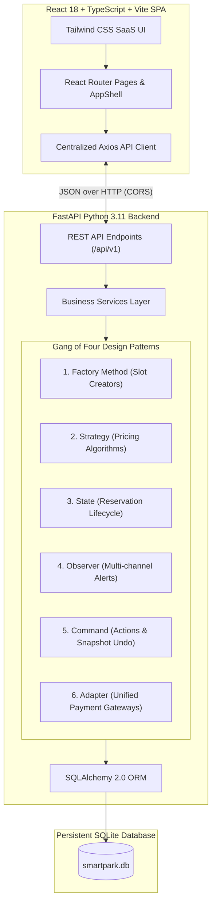
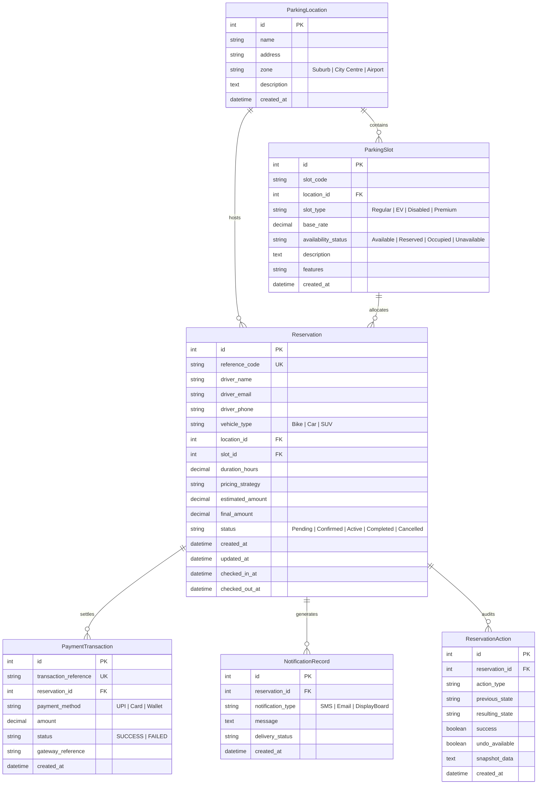
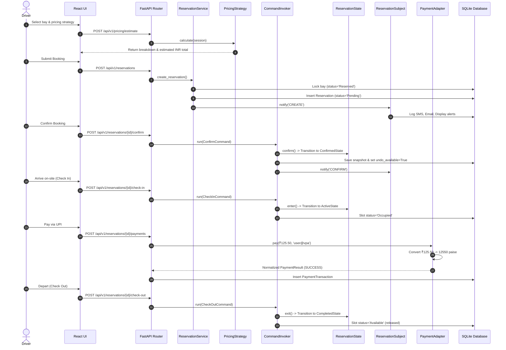

# SmartPark — System Architecture & Design Specification

## 1. System Overview

SmartPark is built using a clean layered architecture with a clear separation of concerns between API routing, business domain logic, Gang of Four design patterns, persistent data models, and a modern single-page frontend.

---

## 2. Database Schema (Entity-Relationship)

---

## 3. Pattern Interactions in the Core Workflow

When a driver books, confirms, enters, and exits a parking slot:

